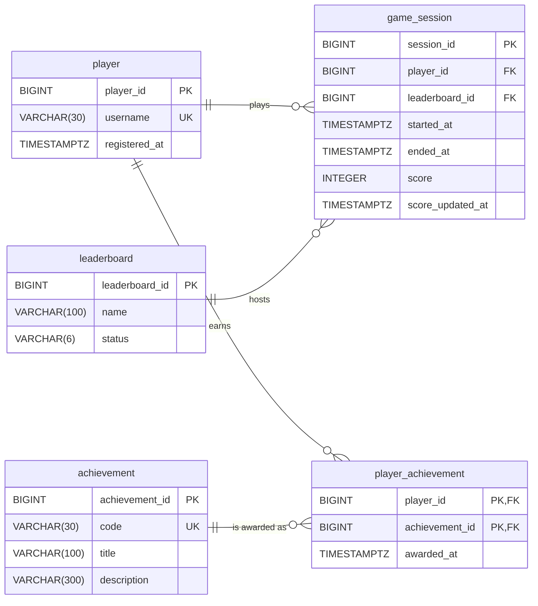

# Real-time Game Leaderboard Database Design ER Diagram

## Reading the Diagram

**PK (primary key)** is the field, or group of fields, that identifies each row uniquely. In `player_achievement`, the pair `(player_id, achievement_id)` is the primary key, so each player can earn each achievement only once.

**FK (foreign key)** is a field that points to the primary key of another table. In `game_session`, `player_id` and `leaderboard_id` link each session to an existing player and an existing leaderboard.

**UK (unique key)** is a field whose values cannot repeat. `player.username` and `achievement.code` are unique.

**Relationship symbols** are read at each end of a line:

- `||` means exactly one.
- `|o` or `o|` means zero or one.
- `o{` means zero or many.

Every relationship in this design has `||` on the parent side and `o{` on the child side. A player (`||`) has zero or many sessions (`o{`), and each session belongs to exactly one player. The same pattern applies to `leaderboard` and `game_session`. The tables `player` and `achievement` each link one to many to `player_achievement`, which together form the many-to-many relationship between players and achievements. No relationship in this design uses zero or one.

**Example:** Ana is one row in `player`. She has sessions on Board A and Board B, so she has two `game_session` rows. Her best score on each board gives her one ranking entry per board.

## Optional Fields

Two fields are optional and may be NULL:

- `game_session.ended_at`, which stays empty while a session is active.
- `achievement.description`.

All other fields are required.

## Rules Needing Additional Constraints or Transaction Logic

- **Rule 4:** A unique index on `(player_id, leaderboard_id)` that applies only where `ended_at` is missing stops a player having two active sessions on the same board.
- **Rule 5:** The score update operation changes only rows where `ended_at` is missing, because a key cannot stop updates to ended sessions.
- **Rule 6:** Session creation and score updates check in one transaction that the leaderboard is open, because a key cannot see another table. A trigger can repeat this check.
- **Rule 7:** Rankings come from a query, not a stored table. The query takes each player's highest score per leaderboard, then orders by score descending, `score_updated_at` ascending and `player_id` ascending.
- **Rule 8:** A trigger or transaction rejects an `awarded_at` earlier than the player's `registered_at`, because a key cannot compare dates across tables.
